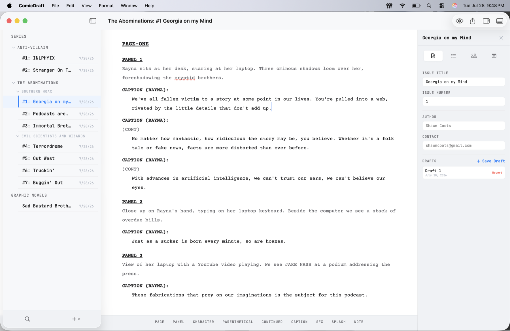

import ScriptBlock from '../../../components/ScriptBlock.astro';
import AppStoreCta from '../../../components/AppStoreCta.astro';
import LearnLinks from '../../../components/LearnLinks.astro';

To write a comic script, break your story into pages, break each page into panels, and for every panel describe what the artist should draw, then add the dialog, captions, and sound effects that go in it. There is no single official format, but most comic scripts follow the same conventions: a heading for each page, a numbered heading for each panel, and lettering written under the panel it belongs to.

This guide covers the format, a full example page, how to plan before you write, and the mistakes that make a script hard to draw.

## What a comic script is for

A screenplay is read by actors and a director. A comic script is read by an artist, a colorist, a letterer, and an editor, and each of them is looking for something different:

- **The artist** needs to know what to draw in each panel, and how many panels fit on the page.
- **The letterer** needs every balloon, caption, and sound effect, in order, attached to the right panel.
- **The editor** needs to see the story's pacing page by page, and whether the page count works.

A good script makes all three jobs easy. That's what the format is for: it isn't decoration, it's a set of handoff conventions between collaborators.

## Comic book script format

Every element below has a fixed job. Keep them consistent and anyone on the team can find what they need at a glance.

### Pages

Each page starts with a page heading. Many writers spell the number out, as in `PAGE-ONE`, so it can't be confused with a number in the dialog or a panel count. Start a new page heading every time the reader turns or moves to a new page, and never let one page's panels run onto the next.

### Panels and panel descriptions

Each panel gets a numbered heading, starting again at `PANEL 1` on every page, followed by a description of what's in the frame.

A panel shows **one moment**. Describe who is in the shot, what they're doing, where they are, and anything the reader must see for the story to make sense. Mention the camera when it matters, like a wide establishing shot or an extreme close-up, and otherwise leave the staging to the artist.

Keep descriptions short. If you need two sentences of action that happen one after the other, you probably have two panels.

### Dialog and characters

Dialog goes under the character's name, in capitals, followed by a colon. The spoken line is indented below it. A short parenthetical between the name and the line, like `(whispering)` or `(into radio)`, tells the letterer how the balloon should look or where its tail points.

When a character's speech is split across two balloons in the same panel, mark the second one as continued with `(CONT)`.

### Captions

Captions are the boxes that carry narration, a character's inner voice, or a time and place. A plain `CAPTION:` is the narrator. `CAPTION (MARA):` attributes it to a character, which tells the letterer to style it as that character's voice.

### Sound effects (SFX)

Sound effects get their own line, `SFX:`, with the sound itself below it. Write the sound as you want it lettered, like `KRAKOOM` or `tk tk tk`. Leave the size and style to the letterer unless it matters to the story.

## A full example page

Here's one complete page with four panels, using every element above.

<ScriptBlock
  caption="One page, four panels: a page heading, panel descriptions, captions, dialog with a parenthetical, and a sound effect."
  text={`
PAGE-ONE

PANEL 1
Wide establishing shot. A rain-soaked rooftop at night, the city skyline glowing behind it. MARA VANCE (30s, long coat, drenched) crouches at the ledge, watching the street through binoculars.

CAPTION: Nine nights on this roof.

PANEL 2
Close on Mara's face. Rain runs off her hood. Her eyes narrow.

CAPTION (MARA):
  Tonight he finally showed.

PANEL 3
Mara's POV through the binoculars: a black van idling in the alley below. A MAN IN A GREY SUIT steps out, holding a briefcase.

PANEL 4
Mara stands, already reaching for the radio clipped to her coat.

MARA:
  (into radio)
  He's here. Grey suit, black van, the alley off Fifth.

SFX:
  KSSHHK

RADIO (OFF):
  Copy. Hold your position.
`}
/>

A few things to notice:

- **Panel 1 sets the scene.** The first panel on a page, especially the first page, usually tells the reader where they are.
- **Panel 3 has no lettering.** Silent panels slow the reader down. Use them for a reveal or a beat of tension.
- **Panel 4 carries the most text, and it's the last panel.** Dialog that leads into the next page belongs at the bottom, where the reader's eye ends up before the turn.

## Planning before you write

Most script problems are planning problems. Ten minutes here saves a rewrite later.

### Story, outline, and page count

Know your page count before you start. A standard American single issue runs about 20 to 22 story pages. A graphic novel can be anything from 48 pages to several hundred, and a webcomic or webtoon is measured in episodes rather than pages.

Then outline. List the story's beats and decide roughly which pages each one gets. If a beat that matters gets half a page and a minor one gets three, you'll see it in the outline long before you see it in the art.

### Pacing across the page turn

In a printed comic, the reader sees two pages at a time, and the page turn hides what comes next. Page one sits on the right, so every even-numbered page is a left-hand page the reader only sees after turning.

That makes even pages the place for reveals: the cliffhanger at the bottom of an odd page, the answer at the top of the next even one. Plan your biggest moments around the turn.

The page also sets the speed. Fewer, larger panels slow the reader down and give a moment weight. More, smaller panels speed things up. Most pages land between four and six panels. A full-page splash is a single panel and the slowest beat you have, so save it for the moments that earn it.

## Common mistakes

- **More than one action per panel.** "She draws her gun, fires, and dives behind the car" is three panels. An artist can only draw one moment.
- **Too many words.** Every balloon covers art. As a rough guide, keep a panel to two or three balloons, and a balloon to about 25 words.
- **Describing what can't be drawn.** "She remembers her father" isn't a picture. Show what the reader should see: a photo in her hand, a flashback panel, a look.
- **Numbering by hand.** Cut a panel from page six and every panel and page number after it is wrong. Renumbering by hand is how scripts end up with two page sevens.
- **Ignoring the page turn.** A reveal on an odd page is spoiled before the reader gets there, because they can already see it on the facing page.

## Doing this in ComicDraft

Everything above is what [ComicDraft](/) formats for you as you type. Start a line with a page or panel and it becomes a heading; type a character name and a colon and the next line is indented for dialog. `CAPTION`, `SFX`, parentheticals, and `(CONT)` each have their own shortcut, ⌘1 through ⌘9, or a button on the Format Bar.

Pages and panels number themselves, and renumber the moment you add, cut, or move one. Press ⌘8 for a splash page and the two page headings collapse into one. When you're done, export a PDF for your artist and letterer.

See [Writing a Script](/guides/writing-a-script/) in the user guide for every element and shortcut.

<AppStoreCta />

## Keep learning

<LearnLinks />
